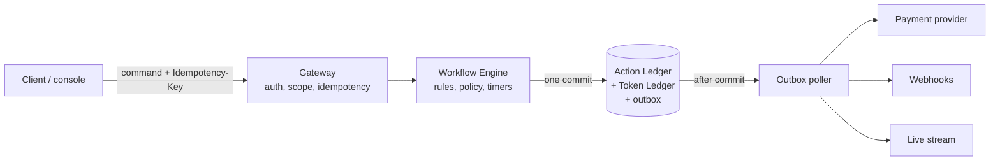

# 1. Overview

## What TaaS is

TaaS is a platform for **tokens**: whole-number units of value that a customer can earn, buy, hold, send and
spend. It supports two kinds today:

| Kind | Example | How a customer gets units | What limits apply |
|---|---|---|---|
| **Loyalty** | `LOYALTY_MPR`, "M-Rewards Points" | Earned automatically when a qualifying payment settles; the rule set decides how many | Lapse after 12 months of inactivity |
| **Asset** (fractional real-world asset) | `RWA_APT001`, a share of an apartment in Kilimani | Bought: reserve units, place an order, pay through M-PESA | Verified KYC; no holder above 20% of the asset; reservations expire if unpaid |

The platform's central claim is that **both kinds go through the same gateway, the same engine and the same two
ledgers**. Only the rule set and the token type differ. The console's "Two flows, one platform" screen exists to
make that visible.

## The three components

| Component | Question it answers | Where it lives |
|---|---|---|
| **Workflow Engine** | What is allowed to happen? | `com.taas.workflow` |
| **Action Ledger** | What happened, and why? | `action_event` table, `com.taas.ledger.ActionLedger` |
| **Token Ledger** | Who owns what right now? | `token_movement` and the derived `holding` table |

## Claims the platform makes, and how each is proven

| Claim | How it is guaranteed | How you can check it |
|---|---|---|
| Every balance can be explained | A balance is the sum of movements; every movement cites the action that caused it | Ledger Explorer: open any event to see its movements and reason |
| History cannot be rewritten | Database triggers refuse UPDATE, DELETE and TRUNCATE; events are hash-chained | `GET /v1/ledger/verify`; tests try to tamper and are refused |
| State can be rebuilt from history | One function (`Projector.apply`) turns events into state, live and on replay | `POST /v1/ledger/replay` reports "holdings identical" |
| A retry never doubles an effect | Every write carries an idempotency key; the stored reply is returned | Send the same request twice; the second has `Idempotent-Replay: true` |
| Nobody exceeds 20% of an asset; nothing is oversold | `CHECK` constraints on the derived holding | The bid storm: 200 parallel bids, the cap holds exactly |
| Failures are visible | Rejections, expiries and payment failures are ledger events with their own colour | The event tape and the Ledger Explorer |

## Glossary

| Term | Meaning |
|---|---|
| **Token** | A type of unit, e.g. `LOYALTY_MPR` or `RWA_TWR014`. Defined once with its supply, price and limits. |
| **Unit** | One indivisible piece of a token. Always an integer, never a fraction or a float. |
| **Authorised supply** | The most units of a token that can ever exist. |
| **Issue / mint** | Create units of a token, from `@mint` into `@treasury`. |
| **`@mint`, `@treasury`, `@burn`** | System accounts. Units are created at `@mint`, wait in `@treasury`, and are retired into `@burn`. Account ids starting with `@` are reserved. |
| **Holding** | How many units an account has of a token: *available* (theirs to use) and *reserved* (held for a pending purchase). |
| **Movement** | One signed change to one account's bucket. The movements of one action always sum to zero. |
| **Action / event** | One entry in the Action Ledger, e.g. `TOKEN_TRANSFERRED`. Records who, what, when, the rule version, and why. |
| **Projection** | A table derived from the Action Ledger (movements, holdings, reservations, orders, rule versions). Can be deleted and rebuilt. |
| **Replay** | Deleting every projection and rebuilding it from the Action Ledger, then comparing. |
| **Reservation** | Units moved into a buyer's reserved bucket for up to 15 minutes while they pay. |
| **Order** | A confirmed bid on a reservation. The payment provider is charged after the order commits. |
| **Rule set** | A versioned document of rules that decide loyalty awards, e.g. `loyalty.default@v7`. |
| **Policy decision point (PDP)** | The component that answers "is this customer allowed?": KYC, frozen accounts, velocity, account binding. |
| **Idempotency key** | A client-chosen string sent with every write. The same key always gets the same answer. |
| **Outbox** | Rows written in the same transaction as the events, published to other systems after the commit. |
| **KYC tier** | 0 = not verified; 1 = identity verified (purchases up to KES 100,000); 2 = address and source of funds verified (no limit). |
| **Business** | The company behind a token: the issuer of an asset (Riverside Properties Ltd) or the operator of a loyalty programme. Verified by compliance before assets are listed under it. |
| **Staff user** | A named person with one role (admin, rules manager, operations, compliance, auditor). The ledger records their actions under their user id. |
| **Persona** | A sign-in role in the demo: admin, rules manager, operations, compliance, auditor, customer. |

## The example data

**Load example data** (console) or `POST /v1/dev/seed` creates:

| Token | What it is | Supply | Price per unit |
|---|---|---|---|
| `LOYALTY_MPR` | M-Rewards Points; 1 unit redeems for KES 10 | 100,000,000 authorised, 10,000,000 issued | n/a |
| `RWA_APT001` | Riverside Apartment 001, Kilimani (valued KES 25M) | 1,000,000 | KES 25 |
| `RWA_TWR014` | Telecom Tower 014, Nakuru (valued KES 12M) | 10,000 | KES 1,200 |
| `RWA_FARM07` | Avocado Farm 07, Murang'a (valued KES 5M) | 50,000 | KES 100 |

It then plays the brief's stories, including the failures: John earns 100 points on a KES 60,000 spend (rule v7),
sends 20 to Alice and redeems 10, leaving 70; Grace's KES 800 spend does not qualify; John's transfer of 500 is
refused; Alice and Bob buy apartment shares; Peter (no KYC) is refused; Mary reserves tower units and never pays
(they come back after 60 seconds); Grace's 2,500-unit tower bid is above the 20% cap and the database refuses it.

It also registers the business behind each token (M-Rewards Ltd, Riverside Properties Ltd, Nakuru Towers Ltd and
Murang'a Avocado Growers Co-operative), has a second officer verify each, and names it as the token's issuer.

The customers are John, Alice, Mary, Bob and Grace (verified, tier 2), Peter (not verified) and `bidder-01`…`bidder-20`
(verified; used by the bid storm).
