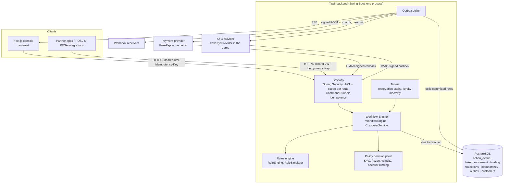
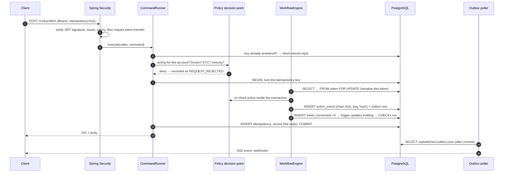

# 2. Architecture

## System context



Everything runs in one Spring Boot process against one PostgreSQL database. The brief's Kafka and Redis are not
needed for the demo; the seams where they slot in are named [below](#where-kafka-and-redis-slot-in).

## The transaction path

Every write, whether it comes from a person, a partner system, a timer or a payment provider, takes the same
path. The diagram follows a transfer.



What the path guarantees:

- **One commit.** The event, its movements, the derived holding, the workflow projection, the outbox row and the
  stored reply are written in one transaction. Either all of it happened or none of it did.
- **Publishing after the commit.** Nothing reaches the PSP, a webhook or the live stream until the transaction has
  committed. "Did the customer get their tokens?" is answered by the ledger, never by a broker.
- **Failures are recorded.** If the policy check, the workflow or a database constraint refuses the command, that
  transaction rolls back and a second, separate transaction records `REQUEST_REJECTED` with the reason and stores
  the refusal as the key's reply.

## Concurrency and locking

| Lock | Taken by | Purpose |
|---|---|---|
| Idempotency key: `pg_advisory_xact_lock(1, hashtext(client ‖ key))` | `IdempotencyStore.lock` | Two requests with the same key cannot both run; the second waits, then gets the stored reply |
| Token row: `SELECT … FROM token FOR UPDATE` | `Registry.lockToken` | Writes to one token are serialised; writes to different tokens run in parallel |
| Chain lock: `pg_advisory_xact_lock(0x7AA5)` | `ActionLedger.append` | Sequence numbers are gapless and the hash chain is linear |
| Customer row: `SELECT … FROM account_profile FOR UPDATE` | `CustomerDirectory.lock` | KYC steps on one customer are serialised |
| `LOCK TABLE token IN ACCESS EXCLUSIVE MODE` | `Projector` (replay, wipe) | Nothing writes while the projections are rebuilt |

The lock order is always **key → token → chain**, and replay takes **token table → chain**, so they cannot deadlock.
The chain lock is held only from the append to the commit; it is the platform's single serialisation point and
the first thing to change for higher write throughput (see [design decisions](10-decisions.md)).

The invariants do not depend on these locks being right: they are `CHECK` constraints on the row that actually
commits.

## Code map

```
src/main/java/com/taas/
├── api/          HTTP layer: controllers, security, OpenAPI, dev endpoints
│   ├── SecurityConfig        JWT validation, scope per route, CORS
│   ├── Http                  reads the caller (client id, idempotency key, bound account) from the request
│   ├── ApiErrors             maps exceptions to RFC 7807 problem responses
│   ├── TokenController       /v1/tokens, /v1/issuances
│   ├── OperationsController  /v1/awards, reservations, orders, transfers, redemptions
│   ├── AccountController     /v1/accounts/{id}/portfolio
│   ├── PaymentController     /v1/payments/callback (HMAC)
│   ├── CustomerController    /v1/customers…, /v1/kyc/callback (HMAC)
│   ├── LedgerController      /v1/ledger/… (actions, proof, movements, stream, verify, replay, wipe)
│   ├── RulesController       /v1/rules… (catalogue, publish, evaluate, simulate)
│   ├── EventStream           SSE subscriber of the outbox
│   ├── DevController         /v1/dev/… personas, dev token, seed, bid storm
│   ├── JwtIssuer             signs dev tokens (HS256)
│   └── OpenApiConfig         Swagger UI, bearer scheme, "/" redirect
├── workflow/     the Workflow Engine
│   ├── CommandRunner         the write pipeline: idempotency, policy, transaction, rejection recording
│   ├── IdempotencyStore      idempotency_record table and its advisory lock
│   ├── WorkflowEngine        define, issue, publish rules, award, reserve, release, order, payment, expire,
│   │                         transfer, redeem, revoke
│   ├── Timers                reservation expiry and loyalty inactivity
│   ├── Commands, Reply       request records and the reply type
├── ledger/       the two ledgers and their projections
│   ├── ActionLedger          append (with hash chain and outbox row), queries
│   ├── ActionEvent           an event and its hash computation
│   ├── EventType             every event type and its outcome colour
│   ├── MovementRules         the single mapping from event type to movements
│   ├── Projector             apply / replay / wipe / verify
│   ├── TokenLedger           movements, holdings, supply, snapshots
│   ├── Registry              token definitions, reservations, orders, rule versions
│   └── Accounts              @mint, @treasury, @burn and account-id validation
├── rules/        RuleSet (parse), RuleEngine (evaluate), RuleSimulator (dry-run over history)
├── policy/       PolicyDecisionPoint
├── customer/     CustomerService, CustomerDirectory, FakeKycProvider, KycSignature
├── payment/      PaymentGateway, FakePsp, PaymentSignature
├── outbox/       OutboxPoller, OutboxSubscriber, PaymentDispatcher, WebhookPublisher
└── common/       Rejection, InvalidRequest, NotFoundException, Hashes, CallbackSignature

src/main/resources/db/migration/   Flyway: V1 (MVP, superseded), V2 (platform), V3 (customers and KYC)
console/                           Next.js 16 / React 19 console (App Router, client components)
```

## Outbox subscribers

The outbox poller reads committed, unpublished rows every 300 ms (`FOR UPDATE SKIP LOCKED`, batches of 200) and
hands each event to every `OutboxSubscriber`. Delivery is at-least-once, so each subscriber is idempotent.

| Subscriber | Reacts to | Does |
|---|---|---|
| `PaymentDispatcher` | `ORDER_PLACED` | Charges the PSP with the order's idempotency key |
| `FakeKycProvider` | `KYC_SUBMITTED` | Decides after ~2 s and sends a signed callback to `/v1/kyc/callback` |
| `WebhookPublisher` | every event | POSTs to each `TAAS_WEBHOOK_URLS` entry with `X-TaaS-Signature: t=…,v1=…` |
| `EventStream` | every event | Pushes to connected SSE clients (`/v1/ledger/stream`) |

## Where Kafka and Redis slot in

| Brief component | Stand-in today | Seam |
|---|---|---|
| Kafka (event bus) | Outbox poller calling in-process subscribers | `OutboxSubscriber`: a Kafka publisher is one more subscriber, or replaces the poller with Debezium CDC on `outbox` |
| Redis (velocity counters, caches) | `count(*)` over `action_event` in the last hour | `PolicyDecisionPoint.requireWithinVelocity` |
| Temporal-style durable timers | `@Scheduled` ticks that read the projections | `Timers`: the state is in the database, so a restart loses nothing |
| An identity provider | `POST /v1/dev/token` (HS256, shared secret) | `SecurityConfig.jwtDecoder`: swap for a JWKS URI |
