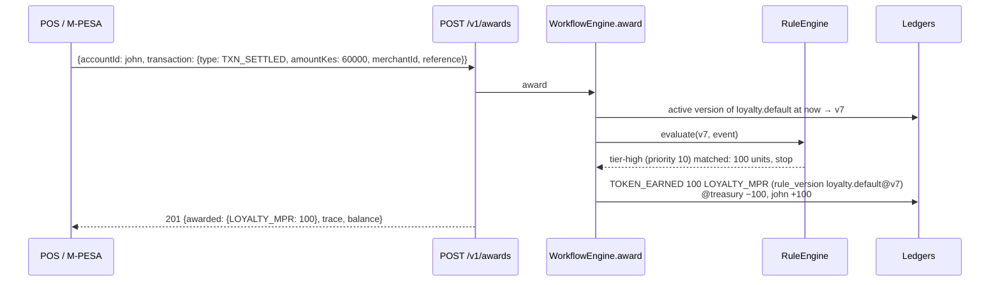
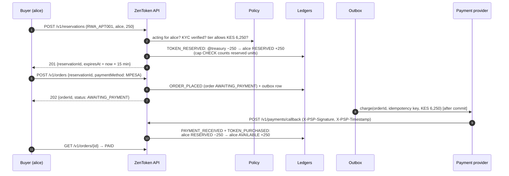

# 4. Workflows

Every workflow below goes through the same pipeline (`CommandRunner.execute`):

1. **Answered already?** If this client has used this idempotency key before, return the stored reply. Same key
   with a different body → `409`.
2. **Policy first.** The policy decision point runs before any transaction. A deny never reaches the workflow.
3. **One transaction.** Lock the key, lock the token row, re-check policy, record the event(s), let the database
   check the invariants, store the reply, commit.
4. **Rejections are events.** Any refusal rolls that transaction back and is recorded on its own as
   `REQUEST_REJECTED`, with the refusal stored as the key's reply, so a retry gets the same answer.

## Loyalty: earning points

The client submits **a transaction, never an amount**. The rule set decides what is earned.

- If no rule matches, `AWARD_NOT_QUALIFIED` is recorded (grey, "declined"), with what was evaluated. It is a decision worth
  keeping: "why didn't Grace get points?" has an answer.
- The event records the inputs (`amountKes`, `merchantId`, `channel`, `reference`), the rule set and version, and
  which rules matched (`matched: tier-high:100`). That is what makes [simulation](05-rules-and-policy.md#simulation)
  exact.
- One transaction may award several tokens if the rules say so; each gets its own `TOKEN_EARNED`.

## Asset purchase: reserve → order → pay → own

The order's state is a projection of the events, so `GET /v1/orders/{id}` always agrees with the ledger.

### The paths where it does not work out

Each of these is a normal path with its own event, not an exception.

| What happens | Events recorded | Units | Order ends as |
|---|---|---|---|
| Buyer releases the reservation before ordering | `TOKEN_RESERVATION_RELEASED` | back to treasury | (no order) |
| Nobody pays; the hold runs out | `TOKEN_RESERVATION_EXPIRED` (by `timer:reservation-expiry`) | back to treasury | `EXPIRED` |
| PSP says the payment failed | `PAYMENT_FAILED` | back to treasury | `PAYMENT_FAILED` |
| Payment arrives after the hold ran out | `PAYMENT_RECEIVED`, `TOKEN_RESERVATION_EXPIRED` (if the timer had not run yet), `PAYMENT_REFUND_REQUIRED` | back to treasury | `REFUND_REQUIRED` |
| PSP paid a different amount | `PAYMENT_RECEIVED`, `PAYMENT_REFUND_REQUIRED` (`AMOUNT_MISMATCH`) | stay reserved until expiry | `REFUND_REQUIRED` |
| Order placed after the hold ran out | `REQUEST_REJECTED` (`RESERVATION_EXPIRED`, 409) | unchanged | (no order) |
| Order placed on a closed reservation | `REQUEST_REJECTED` (`RESERVATION_RELEASED`, `RESERVATION_PURCHASED`, …, 409) | unchanged | (no order) |
| A second order on the same reservation | `REQUEST_REJECTED` (`ORDER_EXISTS`, 409) | unchanged | first order unchanged |
| The same PSP callback is delivered twice | nothing new: the callback's `pspEventId` is its idempotency key | unchanged | unchanged |

**The timer wins.** Once `expiresAt` has passed, the reservation is over, whether or not the timer has fired yet.
A late payment cannot buy the units; it records that a refund is owed. This is what the brief asks for: "a later
order against that reservation fails cleanly".

**Releasing an order awaiting payment is refused** (`ORDER_AWAITING_PAYMENT`): the money may already be on its way,
so only payment failure or expiry can close it.

### The bid storm

`POST /v1/dev/bid-storm` (console: Flows → bid storm) fires 200 reservations of 100 units each at `RWA_TWR014`,
on 32 threads, spread across `bidder-01`… (4 buyers by default, up to 20). Each buyer can hold at most 2,000 units
(20% of 10,000), so with 4 buyers 80 bids succeed and 120 are refused with `OWNERSHIP_CAP`. The result is read back
from the derived holdings: no buyer above 20%, and the treasury is never oversold (`SOLD_OUT` once it runs out).
The bids hold for 60 seconds, then the expiry timer returns the units.

## Transfers

`POST /v1/transfers {tokenId, fromAccountId, toAccountId, units}`, recorded as `TOKEN_TRANSFERRED`.

Checks, in order:

1. The caller may act for `fromAccountId` (customers: only their own account).
2. The sender is not frozen.
3. The receiver is eligible: verified KYC at a tier that covers the value, for asset tokens; not frozen, for loyalty.
4. Velocity: the sender has made fewer than `TAAS_MAX_TRANSFERS_PER_HOUR` (default 20) transfers in the last hour.
5. The database: the sender has the units (`INSUFFICIENT_UNITS`) and the receiver stays under the cap
   (`OWNERSHIP_CAP`).

## Redemptions

`POST /v1/redemptions {tokenId, accountId, units}` cashes units in: they move to `@burn` (`TOKEN_REDEEMED`) and their
value is paid to the holder's M-PESA.

- **The rate.** For a loyalty token it comes from the rule version in force when that version sets
  `redemption.kesPerUnit` (see [Rules](05-rules-and-policy.md)); otherwise from the token's own terms (`redeemValueKes`,
  KES 10 for `LOYALTY_MPR`). An asset is redeemed at its unit price. The event records `kesPerUnit`, `valueKes` and
  `rateSource`, and its rule version is the version that set the rate, so a redemption under v8 is still explained by
  v8 after the rate changes again.
- **The payout.** After the commit, the outbox asks the PSP to pay `valueKes` to the holder (a B2C payment). The PSP
  answers through `POST /v1/payments/payout-callback`, signed like the payment callback, which records `PAYOUT_SENT`
  (or `PAYOUT_FAILED`). Neither moves units. A resent callback changes nothing.
- **The receipt.** `GET /v1/redemptions/{id}` gives the redemption with its payout: `PENDING` until the PSP answers,
  then `PAID` with the M-PESA reference, or `FAILED`. The Operations screen shows it as it happens.

## Issuance and token definition

- `POST /v1/tokens` records `TOKEN_DEFINED`. Asset tokens default to a 20% cap, KYC required and a 15-minute
  reservation. Loyalty tokens default to the `loyalty.default` rule set. A token id can be defined once.
- `POST /v1/issuances` records `TOKEN_ISSUED`: `@mint` → `@treasury`. The supply ceiling is a database constraint;
  issuing past it is refused with `SUPPLY_CEILING`.

## Timers

| Timer | Interval | Finds | Records | Actor |
|---|---|---|---|---|
| Reservation expiry | every 2 s | `HELD` reservations past `expiresAt` | `TOKEN_RESERVATION_EXPIRED` | `timer:reservation-expiry` |
| Loyalty inactivity | every hour | loyalty holders with no movement for `inactivityMonths` (12 for `LOYALTY_MPR`) | `TOKEN_REVOKED` | `timer:loyalty-inactivity` |

Timers are durable because their state *is* the projections: after a restart, the next tick finds the same work.
Each firing is keyed (`expire:<reservationId>`, `revoke:<token>:<account>:<lastActivity>`), so firing twice records
once. A timer that finds nothing to do records nothing.

## Customer onboarding and KYC

Covered in [Access, customers and KYC](06-security-and-kyc.md#customer-lifecycle).
