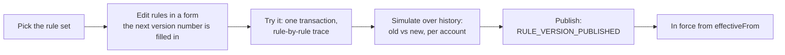

# 5. Rules and policy

TaaS separates three kinds of "rules", because each needs a different guarantee:

| Kind | Example | Who changes it | Enforced by | Guarantee |
|---|---|---|---|---|
| **Business rules** | "KES 1,000 earns 1 point; KES 50,000 earns 100" | Rules manager, without a deployment | Rules engine, from a versioned rule set | Every award names the version that decided it; changes can be simulated first |
| **Policy** | "Asset holders need verified KYC", "max 20 transfers an hour" | Configuration / compliance | Policy decision point | Checked before the workflow and again inside the transaction; a deny is a ledger event |
| **Invariants** | "No holder above 20%", "never exceed authorised supply", "no overdraft" | Token definition | The database (`CHECK` constraints) | Cannot be breached by concurrency or by a bug in the application |

## Rule sets are versioned data

A rule set is a JSON document, published as an event (`RULE_VERSION_PUBLISHED`). Nothing is deployed.

```json
{
  "ruleSetId": "loyalty.default",
  "version": "v7",
  "effectiveFrom": "2026-11-01T00:00:00Z",
  "description": "Adds a high-spend tier. Overlap is explicit: tier-high runs first and stops.",
  "rules": [
    { "id": "tier-base", "name": "Base accrual",
      "when": "event.type == 'TXN_SETTLED' && event.amountKes >= 1000",
      "then": { "award": { "tokenId": "LOYALTY_MPR", "units": 1 } },
      "stopOnMatch": true },
    { "id": "tier-high", "name": "High-spend tier",
      "when": "event.type == 'TXN_SETTLED' && event.amountKes >= 50000",
      "then": { "award": { "tokenId": "LOYALTY_MPR", "units": 100 } },
      "priority": 10, "stopOnMatch": true }
  ]
}
```

- **Versions are immutable.** Publishing an existing `ruleSetId@version` is refused (`VERSION_EXISTS`). To change a
  rule, publish a new version.
- **Which version applies** is the one with the latest `effectiveFrom` that is not in the future. Publishing a version
  with a future `effectiveFrom` schedules it.
- **Every award records its version** (`rule_version = loyalty.default@v7`), so an award made in October under v6 is
  still explained by v6 after v7 takes over.

### What a rule can see

The `when` expression and an expression `units` can read these fields of `event`:

| Field | Example |
|---|---|
| `event.type` | `'TXN_SETTLED'` |
| `event.amountKes` | `60000` (integer) |
| `event.merchantId` | `'naivas-westlands'` |
| `event.channel` | `'POS'`, `'MPESA'` |
| `event.accountId` | `'john'` |

`units` is an integer, or an expression such as `"event.amountKes / 1000"` (integer division): one point per
KES 1,000.

**Expressions cannot run code.** They are Spring Expression Language in a locked-down context: read-only access
to `event` and nothing else. Type references (`T(java.lang.Runtime)`), constructors, bean references, method calls
and assignment are all refused. Expressions are limited to 500 characters and a rule to 1,000,000 units. A set
holds at most 50 rules. Every expression is compiled and test-run against a sample event at publish time, and rules
may only award loyalty tokens that exist.

### Overlap resolution

When more than one rule matches, the result is defined, not accidental:

1. Rules are evaluated in **descending `priority`** (default 0). Ties run in document order.
2. **Every matching rule adds its award.**
3. A match on a rule with **`stopOnMatch: true` ends evaluation.**

With v7, a KES 60,000 spend matches both rules. `tier-high` runs first (priority 10) and stops: **100 units**.
If `tier-high` did not stop, `tier-base` would also match: **101 units**. The Rule Studio shows the trace, rule by
rule, so this is visible before publishing.

## Simulation

`POST /v1/rules/simulate {document, from?, to?}` dry-runs a proposed rule set over the loyalty decisions already in
the ledger (`TOKEN_EARNED` and `AWARD_NOT_QUALIFIED`) and compares each with what was actually awarded. Nothing is
written.

Because each award recorded its inputs and its version, the comparison is exact: "what if customers earned 2 points
per KES 1,000 instead of 1?" returns:

- total units actually awarded vs. under the proposal, and the difference;
- how many decisions change;
- the difference per account;
- each decision, side by side (recorded version and units vs. simulated units and matched rules).

`POST /v1/rules/evaluate {transaction, document? | ruleSetId?}` evaluates a single transaction against a draft or
the version in force and returns the trace. The Rule Studio's **Try it** panel uses it.

## The rule lifecycle in the Rule Studio



Publishing needs the `rules:publish` scope (the rules manager or demo persona). Drafting, trying and simulating
need only `rules:read`.

## The policy decision point

`PolicyDecisionPoint` answers "is this allowed for this customer, now?". It is asked before a workflow starts and
again inside the transaction (after the token row lock), so a customer frozen between the two checks is still caught.

| Check | Applies to | Refusal |
|---|---|---|
| **Account binding**: a customer's token may act only for its own account | reserve, release, order, transfer (sender), redeem, KYC submission | 403 `ACCOUNT_NOT_PERMITTED` |
| **KYC verified** | holding or buying asset tokens (buyer, or transfer receiver) | 403 `KYC_REQUIRED` |
| **KYC tier**: tier 1 may buy up to `TAAS_KYC_TIER1_LIMIT_KES` (KES 100,000) per purchase | asset reservations and transfers by value | 403 `KYC_TIER_TOO_LOW` |
| **Not frozen**: a frozen account keeps its units but cannot buy, send or receive | reservations (buyer), transfers (sender and receiver) | 403 `ACCOUNT_FROZEN` |
| **Velocity**: at most `TAAS_MAX_TRANSFERS_PER_HOUR` (20) transfers out per rolling hour | transfers | 429 `VELOCITY_LIMIT` |

Every deny is recorded as `REQUEST_REJECTED` with its code and reason, so "why was Peter refused?" has an answer in
the ledger.

The catalogue at `GET /v1/rules` lists, for each token, every policy, its value, where it is enforced and by what
mechanism. The Rule Studio shows it as the **Policies** table.
