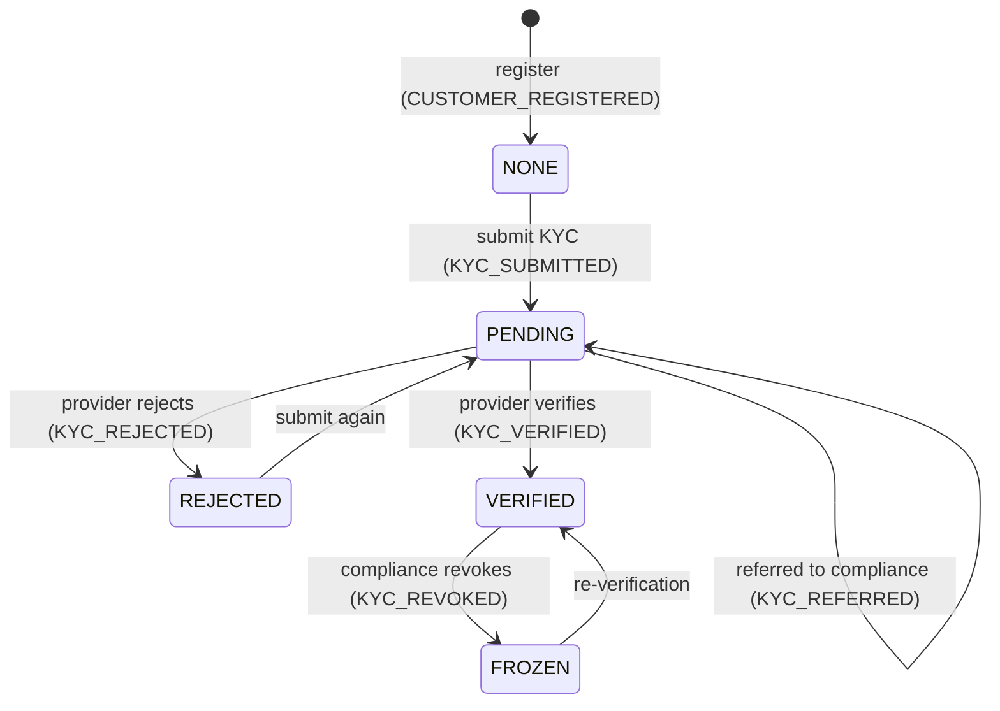

# 6. Access, customers and KYC

## Authentication

Every API call carries `Authorization: Bearer <JWT>`. The gateway (Spring Security as an OAuth2 resource server)
checks the signature, the issuer (`taas`) and the expiry, then the **scope** each route requires.

In the demo the tokens come from `POST /v1/dev/token`, which signs them with a shared HS256 secret
(`TAAS_JWT_SECRET`). In production this endpoint is switched off (`TAAS_DEMO_ENDPOINTS=false`) and tokens come from
an identity provider; the only change is to point the JWT decoder at the provider's JWKS URI.

The exceptions to bearer auth:

| Route | Authenticated by |
|---|---|
| `POST /v1/payments/callback` | HMAC signature: `X-PSP-Timestamp` + `X-PSP-Signature` (mTLS in production) |
| `POST /v1/kyc/callback` | HMAC signature: `X-KYC-Timestamp` + `X-KYC-Signature` |
| `GET /actuator/health`, Swagger UI, `/v3/api-docs` | public |
| `POST /v1/dev/token`, `GET /v1/dev/personas` | public, demo only |

Callback signatures are `HMAC-SHA256(secret, timestamp + "." + body)`, compared in constant time; a timestamp more
than 5 minutes from the server's clock is refused, so a captured callback cannot be replayed later.

## Who can do what: roles and scopes

A **scope** says what kind of thing a caller may do. The console's sign-in menu (top right) offers these roles:

| Role (persona) | Signs in as | Scopes |
|---|---|---|
| Demo operator | `console` | all of them |
| Platform admin | `admin@taas` | `token:read` `token:issue` `ledger:read` `ledger:admin` `rules:read` `customer:read` `customer:register` |
| Rules manager | `rules-manager@taas` | `token:read` `rules:read` `rules:publish` `ledger:read` |
| Operations | `operations@taas` | `token:read` `token:award` `token:trade` `token:transfer` `token:redeem` `ledger:read` `rules:read` `customer:read` `customer:register` `kyc:submit` |
| Compliance officer | `compliance@taas` | `token:read` `ledger:read` `customer:read` `kyc:review` |
| Auditor | `auditor@taas` | `token:read` `ledger:read` `rules:read` `customer:read` |
| Customer | `customer:<accountId>` | `token:read` `token:trade` `token:transfer` `token:redeem` `kyc:submit`, **bound to one account** |

| Scope | Allows |
|---|---|
| `token:read` | tokens, portfolios |
| `token:issue` | define tokens, issue supply |
| `token:award` | submit qualifying transactions for loyalty |
| `token:trade` | reservations and orders |
| `token:transfer` | transfers |
| `token:redeem` | redemptions |
| `ledger:read` | the Action Ledger, movements, proofs, verify, live stream |
| `ledger:admin` | replay, wipe, dev seed and bid storm |
| `rules:read` | rule catalogue, evaluate, simulate |
| `rules:publish` | publish a rule version |
| `customer:read` | customer directory and KYC history |
| `customer:register` | register a customer |
| `kyc:submit` | submit a customer for KYC (a customer: only themselves) |
| `kyc:review` | decide referred cases, revoke (freeze), erase personal data |

A missing or invalid token is a `401`; a token without the route's scope is a `403`. Any route not listed in
`SecurityConfig` is denied.

## Account binding

Scopes say *what* a caller may do; binding says *on whose behalf*. A customer's token carries an `account_id`
claim. The workflow refuses any command for another account (`403 ACCOUNT_NOT_PERMITTED`, recorded in the ledger),
and reads of another account's portfolio, reservations, orders or customer record are refused too. Staff and partner
systems are not bound.

Customers cannot read the Action Ledger (it contains other customers' activity). Their own history is in their
portfolio and KYC timeline.

## Customer lifecycle

| Status | May hold and buy assets | May earn and use loyalty |
|---|---|---|
| `NONE`, `PENDING`, `REJECTED` | no (`KYC_REQUIRED`) | yes |
| `VERIFIED` tier 1 | yes, up to KES 100,000 per purchase | yes |
| `VERIFIED` tier 2 | yes, no limit | yes |
| `FROZEN` | keeps units; cannot reserve, buy, send or receive (`ACCOUNT_FROZEN`) | cannot send or receive transfers; see the note below |

> **Known gap:** a frozen account can still earn loyalty awards and redeem units. Neither path asks the policy
> decision point about freezing today. If a freeze should stop spending too, add `pdp.requireNotFrozen` to
> `WorkflowEngine.redeem` (and to `award`, if it should stop earning).

**The status says what a customer may do; an open case is tracked separately** (`kyc_review` =
`AWAITING_PROVIDER` or `NEEDS_REVIEW`). A tier-1 customer asking for tier 2 stays `VERIFIED` tier 1, and keeps
buying under tier 1, while the case runs. A failed upgrade leaves the existing verification in place.

### The steps

| Step | Who | Endpoint | Event | Refusals |
|---|---|---|---|---|
| Register | Operations, admin | `POST /v1/customers` (name, phone, national ID, date of birth) | `CUSTOMER_REGISTERED` | `UNDERAGE` (under 18), `ACCOUNT_EXISTS` |
| Submit for KYC (tier 1 or 2) | Operations, or the customer themselves | `POST /v1/customers/{id}/kyc` | `KYC_SUBMITTED` | `KYC_IN_PROGRESS`, `ALREADY_VERIFIED`, `NO_PERSONAL_DATA` |
| Provider verdict | The KYC provider (signed callback) | `POST /v1/kyc/callback` | `KYC_VERIFIED`, `KYC_REJECTED` or `KYC_REFERRED` | `CASE_NOT_OPEN` |
| Decide a referred case | Compliance | `POST /v1/customers/{id}/kyc/decision` `{decision: VERIFY \| REJECT, tier, reason}` | `KYC_VERIFIED` / `KYC_REJECTED` | `NO_OPEN_CASE` |
| Revoke (freeze) | Compliance | same, `{decision: REVOKE, reason}` | `KYC_REVOKED` | `NOT_VERIFIED` |
| Erase personal data | Compliance | `DELETE /v1/customers/{id}/pii` | `PII_ERASED` | `NOTHING_TO_ERASE` |

A reason is required to reject or revoke. Decisions record `decidedBy: officer:<who>` so every verification has a
name and a time.

### The demo's KYC provider

`FakeKycProvider` reacts to `KYC_SUBMITTED` (from the outbox, after commit) and answers about 2 seconds later with a
signed callback, like a real provider would:

| Input | Verdict |
|---|---|
| National ID starting with `000` | `REJECTED`: "ID number not found in the national registry" |
| Tier 2 requested | `REFERRED`: proof of address and source of funds need a compliance officer |
| Otherwise | `VERIFIED` at tier 1 |

The provider's event id is the callback's idempotency key, so a redelivered callback changes nothing.

## Personal data stays out of the ledger

The Action Ledger is immutable, so personal data must never go into it: it could not be corrected or erased
(Kenya's Data Protection Act 2019, and GDPR, require both).

- Name, phone, national ID and date of birth live in `customer_pii`, a normal table.
- Ledger events carry only `piiDigest`, a SHA-256 fingerprint of that data, which proves *what* was verified without
  revealing it.
- API reads mask the phone and national ID.
- Erasing the data (`PII_ERASED`) clears the row; the holdings and the ledger history stay intact, and the digest
  still matches the data that was verified at the time. An erased customer cannot be re-verified.

A test checks that a registered customer's ID number, name and phone appear nowhere in `action_event`.

## Why customer data is not a projection

`account_profile` (status, tier, open case) is written in the same transaction as the KYC event that records each
change, but replay does not rebuild it. In a real deployment the onboarding system owns this data, and it holds
personal data the ledger must not. The ledger is the audit trail of every change ("why could Alice buy on 3 March?"),
and the token ownership the replay test proves does not depend on it.

## Not built yet

- A real identity provider (Keycloak, Entra ID, Auth0…) with users, passwords and MFA.
- Customer self-registration (today Operations registers customers).
- Two-person approval for issuing supply and publishing rules.
- A real KYC provider (Smile ID, IPRS lookups, …) and document upload.
- mTLS on the provider callbacks.
